<div align="center">

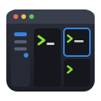

# oxishell

**The terminal for AI coding agents on Linux. Run Claude Code, Codex and Gemini CLI side by side, and get notified the moment one needs you.**

Workspaces in a sidebar · split panes · agent notifications · 41 Warp themes · Ubuntu, Debian, X11 and Wayland

[](https://github.com/Ajinkyasp99/oxishell/actions/workflows/ci.yml)
[](https://github.com/Ajinkyasp99/oxishell/releases/latest)
[](https://github.com/Ajinkyasp99/oxishell/releases)
[](https://github.com/Ajinkyasp99/oxishell/stargazers)
[](LICENSE)
-informational)

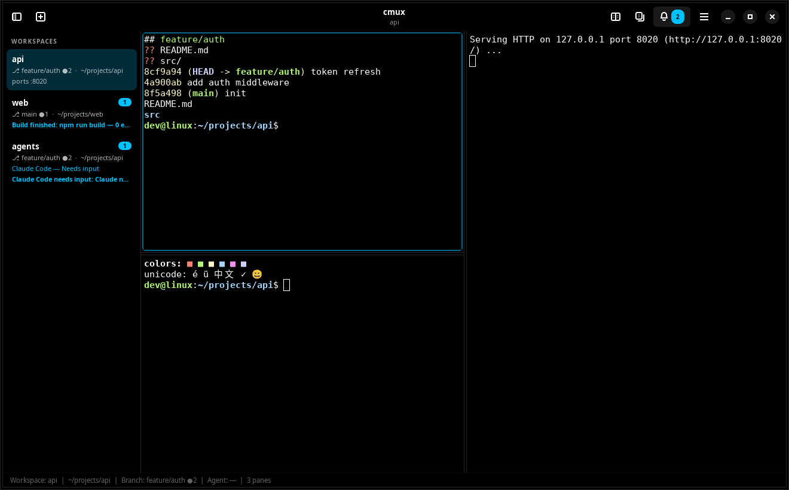

</div>

**oxishell** is a free, open-source terminal app for Ubuntu, Debian and other Linux desktops, made for
developers who run several AI coding agents and dev servers at once. It is a **cmux alternative for Linux**:
it brings the workflow of [cmux](https://github.com/manaflow-ai/cmux) (macOS only) to Linux as a real native
app, written in **Rust + GTK4/libadwaita**, with terminals rendered by **VTE**, the engine behind GNOME
Terminal. No Electron, no browser, no web terminal.

Install on Ubuntu 24.04 / Debian 13 in one line ([details](#install-on-ubuntu-and-debian)):

```bash
wget -qO /tmp/oxishell.deb https://github.com/Ajinkyasp99/oxishell/releases/latest/download/oxishell_amd64.deb && sudo apt install /tmp/oxishell.deb
```

## Why oxishell

When you run Claude Code, Codex or Gemini in several terminals, you keep checking each one to see whether it
finished or is waiting for you. oxishell keeps every project in its own **workspace**, shows each one's git
branch, open ports and agent status in a **sidebar**, and **lights up the pane** the moment an agent needs
input.

## Features

| | |
|---|---|
| 🗂 **Workspaces** | Vertical sidebar with git branch, uncommitted-change count, working directory, listening ports, agent status and unread badges. Background workspaces keep running. Drag to reorder, double-click to rename, ✕ to close (asks first). Right-click → Colour / Icon to mark a workspace (say, red for production). |
| ⊞ **Split panes** | Split right or down, nest them, drag dividers (or the point where two meet, to resize both ways at once), move focus with <kbd>Alt</kbd>+arrows. Drag a pane's ✥ move handle (next to its ✕) onto another pane to swap their places. Each pane is an independent shell. |
| 🔔 **Agent notifications** | Hooks for **Claude Code, Codex, Gemini CLI, Qoder, OpenCode**. A blue ring on the pane, a badge on the workspace, a system notification with sound (stays on screen while an agent waits for input; click it to jump to the pane), and <kbd>Ctrl</kbd>+<kbd>Shift</kbd>+<kbd>U</kbd> jumps to it. Long shell commands notify when they finish in a pane you are not watching. |
| 📊 **Agent limits** | Open Codex and Claude Code sessions show **5-hour and weekly** usage percentages, progress bars and local reset dates/times in AM/PM format at the bottom of the sidebar. Uses local CLI data. |
| 🎨 **Warp themes** | 41 built-in themes from [Warp](https://github.com/warpdotdev/themes), including gradients. They colour the whole window, not just the text. Drop any Warp `.yaml` theme in to add your own. Background opacity lets windows behind show through while text stays solid. |
| 💡 **Command suggestions** | As you type, the newest matching command from your bash/zsh/fish history appears dimmed after the cursor. <kbd>→</kbd> accepts it. <kbd>Ctrl</kbd>+<kbd>Shift</kbd>+<kbd>H</kbd> searches your whole history. |
| 🏷 **Context chips** | Warp-style chips above each terminal: active Python venv/conda env, folder, git branch and changes. The prompt becomes a clean `❯` (red after a failed command). |
| 🧱 **Command blocks** | Warp-style: every command gets a header with its folder, git branch, ✓/✗ exit status and run time. Failed commands get a red edge. Commands you type are highlighted so they stand out from output. |
| 🔗 **Clickable links** | URLs in any output (agents, builds, logs) are clickable. A click opens a small popup with **Open Link** and **Copy Link**; <kbd>Ctrl</kbd>+click opens the link straight away. File positions such as `src/main.rs:42:7` open in your editor at that line. |
| ▮ **Cursor** | Block, vertical line or horizontal line, blinking or steady. |
| ⌘ **Command palette** | <kbd>Ctrl</kbd>+<kbd>Shift</kbd>+<kbd>P</kbd>: every action, workspace, theme and your own project commands, with fuzzy search. |
| 🤖 **Scriptable** | The `oxi` CLI controls the running app over a private local socket: create workspaces, split, read output, send notifications. |
| 💾 **Sessions** | Workspaces, layouts, directories and agent sessions come back after a restart, each terminal clean at the top. Commands are never re-run. |
| 🐧 **Native** | GTK4, X11 and Wayland, light/dark aware, ~180 ms startup, ~1 % idle CPU with 20 panes ([measured](docs/PERFORMANCE.md)). |

## Install on Ubuntu and Debian

### Requirements

| | Minimum | Ubuntu 24.04 package (installed automatically by the .deb) |
|---|---|---|
| OS | Ubuntu 24.04+ or Debian 13+, X11 or Wayland | — |
| GTK | 4.12 | `libgtk-4-1` |
| libadwaita | 1.5 | `libadwaita-1-0` |
| VTE for GTK 4 | 0.76 | `libvte-2.91-gtk4-0` |
| git *(optional)* | any | `git` (branch and changes in the sidebar) |

Check what your system offers before installing (each version must be at least the minimum above):

```bash
lsb_release -ds                     # e.g. Ubuntu 24.04.1 LTS
for p in libgtk-4-1 libadwaita-1-0 libvte-2.91-gtk4-0; do
  printf '%-20s %s\n' "$p" "$(apt-cache policy "$p" | awk '/Candidate/ {print $2}')"
done
```

On Ubuntu 24.04 this prints GTK `4.14`, libadwaita `1.5` and VTE `0.76`. If a line shows `(none)`, run
`sudo apt update` first; if it is still missing, your release is too old.

### Ubuntu / Debian .deb package (recommended)

On a fresh Ubuntu install:

```bash
sudo apt update
sudo apt install -y wget ca-certificates git
wget https://github.com/Ajinkyasp99/oxishell/releases/latest/download/oxishell_amd64.deb
sudo apt install ./oxishell_amd64.deb     # pulls in GTK 4, libadwaita and VTE automatically
```

Then open **oxishell** from your app menu, or run `oxishell`. The `oxi` command-line tool is installed too.

> apt may print `N: Download is performed unsandboxed as root…` when the file is in your home folder.
> That note is harmless.

**Notification sounds** use the system sound theme (`sound-theme-freedesktop`, preinstalled on Ubuntu).
On desktops whose notification server cannot play sounds itself (not GNOME or KDE), also install
`sudo apt install gnome-session-canberra` so oxishell can play them.

### Build from source (Ubuntu, Fedora, Arch)

On a fresh Ubuntu 24.04:

```bash
# 1. Build tools and development headers
sudo apt update
sudo apt install -y build-essential pkg-config git curl \
    libgtk-4-dev libadwaita-1-dev libvte-2.91-gtk4-dev

# 2. Rust 1.87 or newer. Ubuntu's own rustc (1.75) is too old, so use rustup:
curl --proto '=https' --tlsv1.2 -sSf https://sh.rustup.rs | sh -s -- -y
. "$HOME/.cargo/env"
rustc --version                    # must print 1.87 or newer

# 3. Build and run
git clone https://github.com/Ajinkyasp99/oxishell.git
cd oxishell
cargo build --release
./target/release/oxishell
```

To install your build system-wide (app menu entry, `oxi` on PATH), turn it into a package:

```bash
sudo apt install -y dpkg-dev
scripts/build-deb.sh                                     # writes dist/oxishell_<version>_<arch>.deb
sudo apt install --reinstall ./dist/oxishell_*.deb
```

On Fedora (`gtk4-devel libadwaita-devel vte291-gtk4-devel`) or Arch (`gtk4 libadwaita vte4`), install the
equivalent packages. These distros haven't been tested yet; reports are welcome.
Full guide, including uninstalling: [docs/INSTALL.md](docs/INSTALL.md).

### Update

Your settings, themes, workspaces and agent hooks are kept across updates. Close oxishell first (or restart it
afterwards); workspaces come back on the next start.

**Installed from the .deb:** download the latest release and install it over the old one.

```bash
oxi --version                       # the version you have now
wget -O oxishell_amd64.deb https://github.com/Ajinkyasp99/oxishell/releases/latest/download/oxishell_amd64.deb
sudo apt install ./oxishell_amd64.deb
oxi --version                       # the new version
```

**Built from source:**

```bash
cd oxishell
git pull
cargo build --release                                    # run ./target/release/oxishell, or:
scripts/build-deb.sh && sudo apt install --reinstall ./dist/oxishell_*.deb
```

`--reinstall` matters here: a local build keeps the version number, and without it apt says
*already the newest version* and skips the install.

## Quick start

1. **Open a workspace per project:** <kbd>Ctrl</kbd>+<kbd>Shift</kbd>+<kbd>N</kbd>, then rename it with a double-click.
2. **Split:** <kbd>Ctrl</kbd>+<kbd>Shift</kbd>+<kbd>E</kbd> (right) and <kbd>Ctrl</kbd>+<kbd>Shift</kbd>+<kbd>O</kbd> (down). Start your dev server in one pane and an agent in another.
3. **Turn on agent notifications** (one time): <kbd>Ctrl</kbd>+<kbd>,</kbd> → Notifications → Agent Hooks, and switch on
   your agents. Or from a terminal:
   ```bash
   oxi hooks install --all     # sets up every supported agent found on your PATH
   ```
4. **Pick a theme:** <kbd>Ctrl</kbd>+<kbd>,</kbd> → Appearance (→ *Browse all themes* for the full list with search), or
   <kbd>Ctrl</kbd>+<kbd>Shift</kbd>+<kbd>P</kbd> and type `theme`.

When an agent finishes or asks for permission, its workspace gets a badge. Press <kbd>Ctrl</kbd>+<kbd>Shift</kbd>+<kbd>U</kbd> to jump straight to it.

<table>
<tr>
<td width="50%">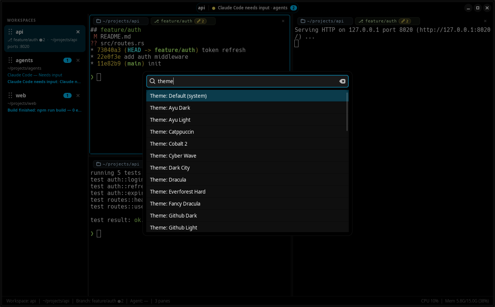<br><sub><b>Command palette:</b> actions, workspaces, themes, custom commands</sub></td>
<td width="50%">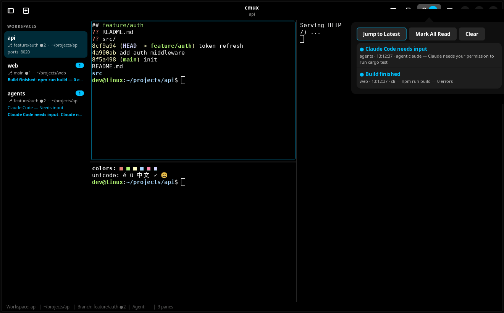<br><sub><b>Notifications:</b> which agent needs you, and where</sub></td>
</tr>
<tr>
<td width="50%">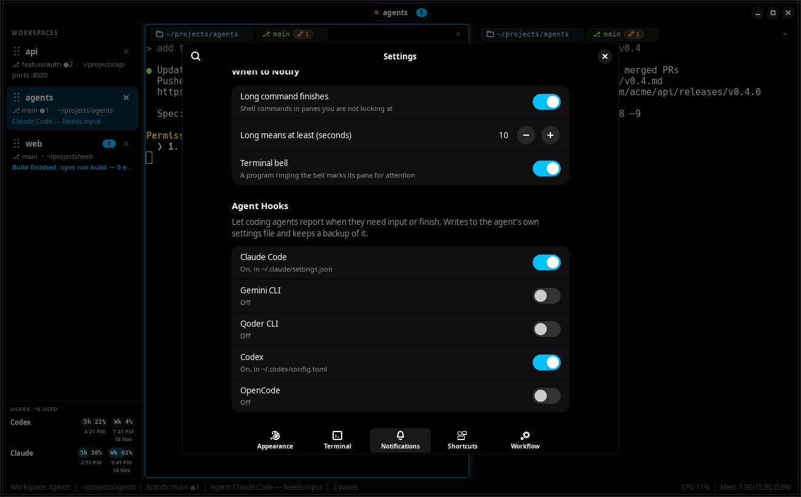<br><sub><b>Agent hooks:</b> one switch per agent in Settings → Notifications</sub></td>
<td width="50%">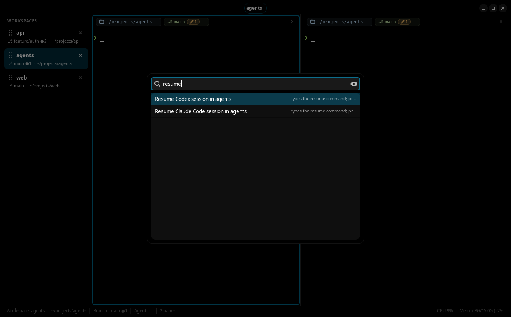<br><sub><b>Sessions:</b> after a restart, resume agent sessions from the palette or pane menu</sub></td>
</tr>
</table>

## Suggestions and context chips

<table>
<tr>
<td width="50%">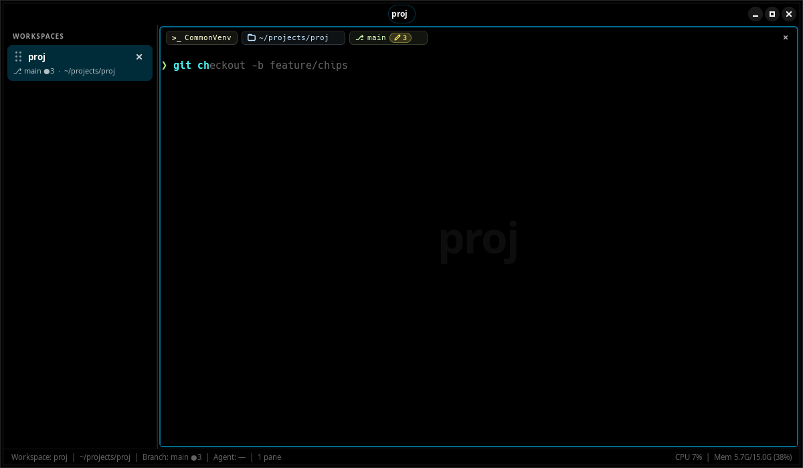<br><sub>Type <code>git ch</code> → the rest comes from your history; press <kbd>→</kbd> to accept</sub></td>
<td width="50%">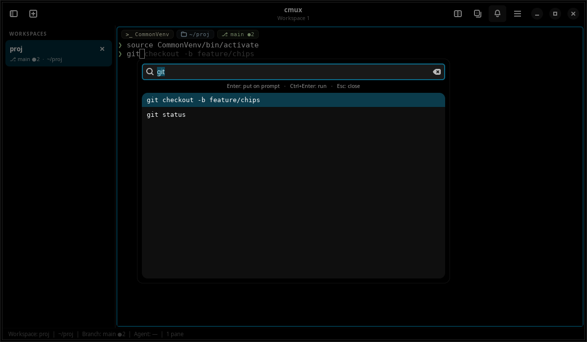<br><sub><kbd>Ctrl</kbd>+<kbd>Shift</kbd>+<kbd>H</kbd>: search history. Enter puts it on the prompt, Ctrl+Enter runs it</sub></td>
</tr>
</table>

Suggestions only appear when you're at a shell prompt (never inside vim, Python and so on), and only while
oxishell can follow your typing exactly (after <kbd>Tab</kbd>, arrow keys or paste they pause until the
next line). The **environment chip** works automatically in bash; for zsh/fish add one line:
`oxi shell-integration zsh >> ~/.zshrc` (or `fish >> ~/.config/fish/config.fish`). Both features can be
turned off in Settings.

Because the chips already show where you are, panes use a compact **`❯` prompt** (green, red after a
failed command) instead of `user@host:~/path$`. This only applies inside oxishell; your `~/.bashrc`,
other terminals and SSH sessions keep their own prompt. Turn it off in Settings → Compact prompt.

## Command blocks and clickable links

<table>
<tr>
<td width="50%">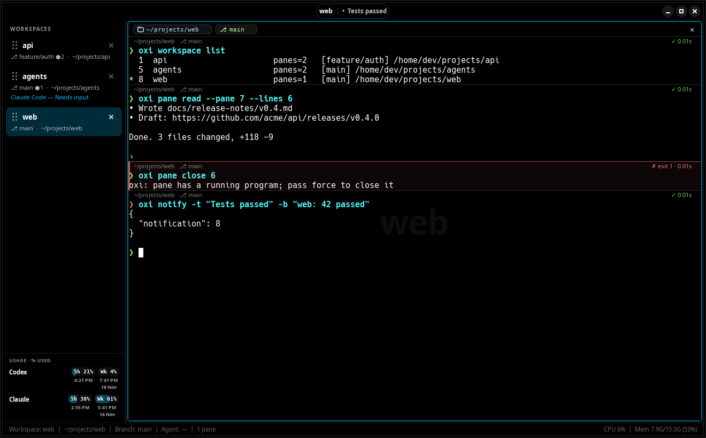<br><sub><b>Command blocks:</b> folder, branch, ✓/✗ and run time for every command. Shown here with the <code>oxi</code> CLI</sub></td>
<td width="50%">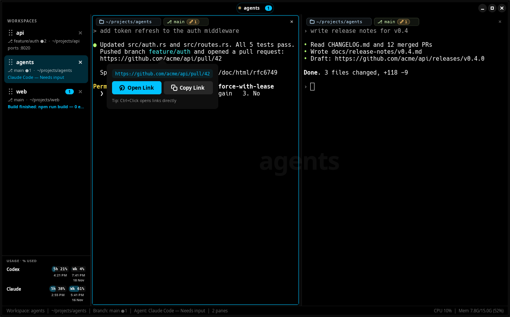<br><sub><b>Links:</b> click any URL for Open / Copy; <kbd>Ctrl</kbd>+click opens it directly</sub></td>
</tr>
</table>

Each command you run at the prompt becomes a **block**: a thin separator, then a header with the folder and git
branch it ran in and, once it ends, ✓ or ✗ with the exit code and how long it took. Failed blocks get a red
edge, so a failing build is easy to spot when you scroll back. Turn blocks off in Settings → Terminal →
Command blocks.

**Links** work in everything that prints a URL: agent replies, test runners, `git push` output, logs.
Clicking one opens a small popup showing the full address with **Open Link** (default browser) and
**Copy Link**. <kbd>Ctrl</kbd>+click skips the popup, and right-clicking a link puts the same two actions at
the top of the context menu. Dragging or double-clicking to select text never opens anything.

**File positions** work the same way. When a compiler, test runner or agent prints `src/main.rs:42` or
`src/main.rs:42:7` (or Python's `File "app.py", line 12`) and that file exists relative to the pane's folder,
clicking it offers **Open in Editor** and **Copy Path**, and <kbd>Ctrl</kbd>+click opens your editor at that
line. The editor is your `$VISUAL`/`$EDITOR` or an installed one (VS Code, Zed, …); set it in Settings →
Terminal → Editor. Terminal editors such as vim or nano open in a new pane.

## Themes

Every theme colours the whole window (background, sidebar, header, badges, focus rings and the terminal),
just like in Warp. Gradient themes such as *Cyber Wave* and *Willow Dream* paint behind the terminal too.

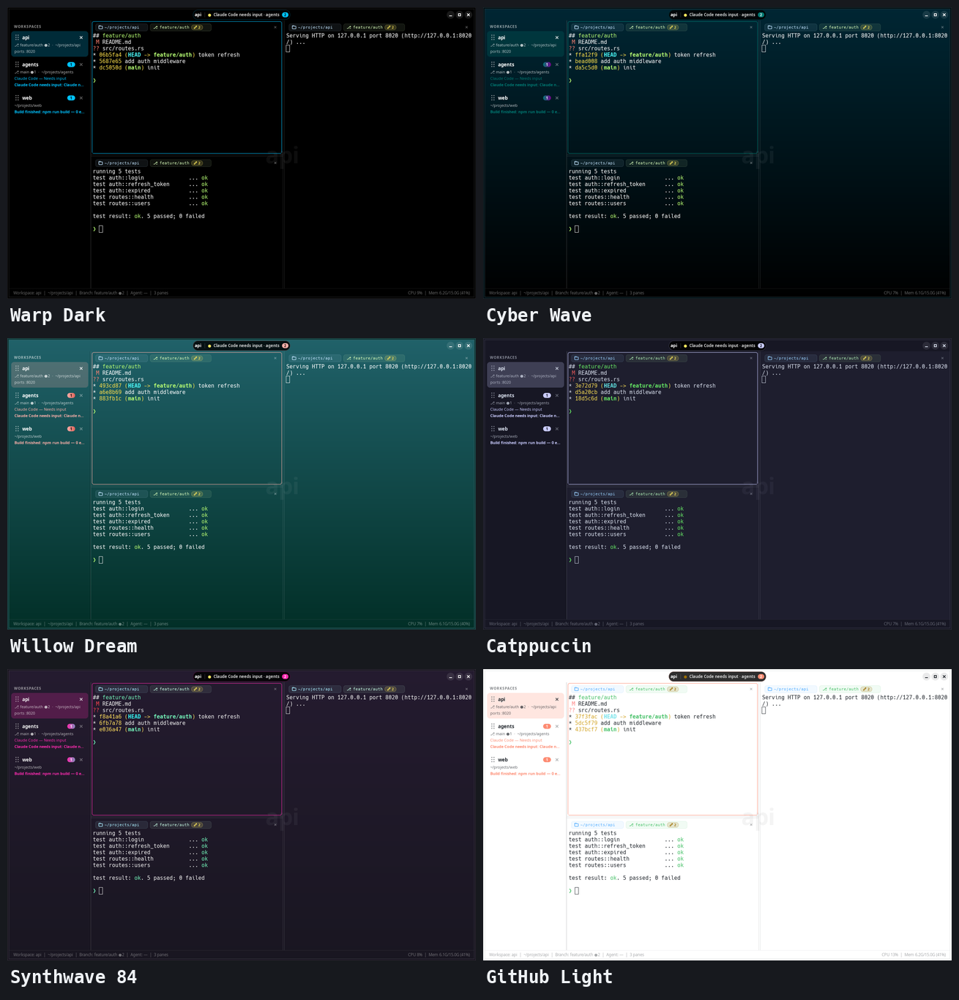

Built in: Warp Dark/Light, Cyber Wave, Willow Dream, Dark City, Fancy Dracula, Jellyfish, Koi, Leafy, Marble,
Pink City, Red Rock, Snowy, Paper Botanical, Dracula, Catppuccin, Nord, Tokyo Night, One Dark, GitHub
Dark/Light, Gruvbox, Solarized, Monokai Pro, Night Owl, Synthwave 84, Ayu, Everforest, Kanagawa, Material,
Cobalt 2, Outrun, Shades of Purple, Poimandres, Vitesse, Palenight, and more.

**Add your own:** put any [Warp theme file](https://github.com/warpdotdev/themes) into
`~/.config/oxishell/themes/`. It shows up in the gallery right away, background images included.
See [docs/THEMES.md](docs/THEMES.md).

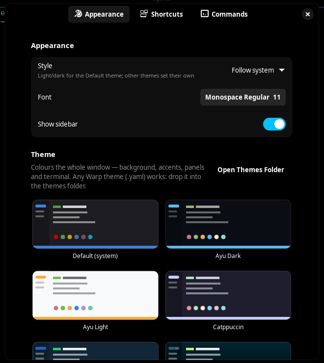

## Keyboard shortcuts

| Action | Shortcut |
|---|---|
| New / close / rename workspace | <kbd>Ctrl</kbd>+<kbd>Shift</kbd>+<kbd>N</kbd> / <kbd>Q</kbd> / <kbd>R</kbd> |
| Next / previous workspace | <kbd>Ctrl</kbd>+<kbd>PgDn</kbd> / <kbd>Ctrl</kbd>+<kbd>PgUp</kbd>, or <kbd>Alt</kbd>+<kbd>1</kbd>…<kbd>9</kbd> |
| Split right / down | <kbd>Ctrl</kbd>+<kbd>Shift</kbd>+<kbd>E</kbd> / <kbd>O</kbd> |
| Close pane | <kbd>Ctrl</kbd>+<kbd>Shift</kbd>+<kbd>W</kbd> |
| Move focus | <kbd>Alt</kbd>+<kbd>←</kbd><kbd>→</kbd><kbd>↑</kbd><kbd>↓</kbd> |
| Command palette | <kbd>Ctrl</kbd>+<kbd>Shift</kbd>+<kbd>P</kbd> |
| New line in a prompt (without sending) | <kbd>Shift</kbd>+<kbd>Enter</kbd> or <kbd>Ctrl</kbd>+<kbd>Enter</kbd> |
| Copy / paste | <kbd>Ctrl</kbd>+<kbd>Shift</kbd>+<kbd>C</kbd> / <kbd>V</kbd> |
| Search scrollback | <kbd>Ctrl</kbd>+<kbd>Shift</kbd>+<kbd>F</kbd> |
| Accept suggestion | <kbd>→</kbd> or <kbd>End</kbd> |
| Search command history | <kbd>Ctrl</kbd>+<kbd>Shift</kbd>+<kbd>H</kbd> |
| Jump to latest unread | <kbd>Ctrl</kbd>+<kbd>Shift</kbd>+<kbd>U</kbd> |
| Notifications panel | <kbd>Ctrl</kbd>+<kbd>Shift</kbd>+<kbd>I</kbd> |
| Toggle sidebar | <kbd>Ctrl</kbd>+<kbd>Shift</kbd>+<kbd>B</kbd> |
| Font size | <kbd>Ctrl</kbd>+<kbd>=</kbd> / <kbd>Ctrl</kbd>+<kbd>-</kbd> / <kbd>Ctrl</kbd>+<kbd>0</kbd> |
| Font zoom alternatives | <kbd>Ctrl</kbd>+<kbd>+</kbd> / keypad <kbd>+</kbd> or <kbd>-</kbd>; hold <kbd>Ctrl</kbd> and scroll up/down over a terminal |
| Settings | <kbd>Ctrl</kbd>+<kbd>,</kbd> |

**New line in a prompt** works in Claude Code, Codex, Gemini CLI and OpenCode (sent as <kbd>Ctrl</kbd>+<kbd>J</kbd>),
and at a bash, zsh or fish prompt, where Enter then runs all the lines. Other programs (vim, REPLs) get the
key unchanged.

All shortcuts can be changed in Settings → Shortcuts. Right-click a workspace or a terminal for more actions.

The default terminal typeface is **Hack**, bundled with regular, bold, italic and bold-italic faces from
Warp's font assets. Existing `Monospace 11` defaults switch to `Hack 11`; other configured fonts are preserved.
Zoom applies to all panes, and <kbd>Ctrl</kbd>+<kbd>0</kbd> returns to the configured font size.

## Command line

```bash
oxi workspace new --name api --cwd ~/src/api   # new workspace
oxi pane split --direction down                # split the current pane
oxi notify -t "Deploy done" -b "prod is green" # ring this pane
oxi workspace list                             # see everything
oxi pane read --lines 50                       # last 50 lines of output
```

Use it from scripts, git hooks or your own agent tooling. Reference: [docs/CLI.md](docs/CLI.md).

## Supported AI coding agents

| Agent | Running | Needs input | Finished |
|---|:-:|:-:|:-:|
| Claude Code | ✓ | ✓ | ✓ |
| Gemini CLI | ✓ | — | ✓ |
| OpenCode¹ | ✓ | ✓ | ✓ |
| Codex CLI² | ✓ | ✓ | ✓ |
| Qoder CLI | — | — | ✓ |
| Anything else | `oxi agent-event` / `oxi notify` from your own scripts | | |

¹ OpenCode support is implemented as a plugin but has not yet been tested against a live OpenCode.
² Codex requires a CLI with lifecycle hooks: run `oxi hooks install codex`, restart Codex, then review
and trust the oxi hooks in `/hooks`. Needs input covers approval requests and `request_user_input`
questions. Older Codex versions can still use the completion-only `notify` integration; see [agent setup](docs/AGENTS.md).

After a restart, sessions whose hooks reported a session id (Claude Code, Gemini, Qoder, and Codex when it
sends a thread id) can be resumed from the pane menu or the palette.

oxishell only shows states that the agent's own hooks report; it never guesses. Hooks are silent no-ops
outside oxishell, so installing them never breaks your agents. Details: [docs/AGENTS.md](docs/AGENTS.md).

### Codex and Claude usage limits

When either agent is open in any workspace, a compact row appears below the workspace list, for example
`Codex  5h 21%  Wk 4%`. Both values show **percentage used** over horizontal usage fills. Small AM/PM reset
times appear directly below each value, with the weekly date (and the 5-hour date when it is on another day).
Hover for full reset details, or click the row to open usage bars and setup details. Unavailable limits show `—`.
Rows disappear when the sessions close.
You also get one notification when a limit passes **80%** and another at **95%** (for example *Claude Code
usage at 80% · 81% of the 5-hour limit used · Resets in 1h 30m*), plus a short note when that window resets.
Each threshold is announced once per window, also across restarts. Turn it off in Settings → Notifications →
Usage limit alerts. Limits are account-wide snapshots, refreshed from data
reported after agent responses; usage from other devices can lag until the CLI reports again.

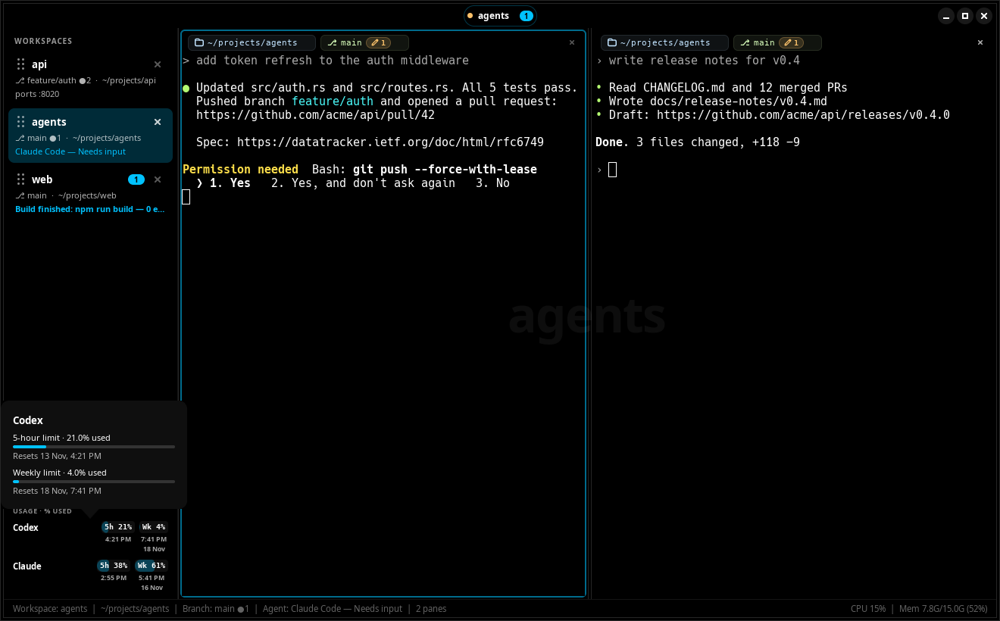

Codex works automatically from local session logs (`CODEX_HOME` is respected). For Claude, run
`oxi hooks install claude` once with the updated `oxi` binary, then restart Claude. This also installs
a status-line bridge to forward Claude's quota data to oxishell. Any existing status-line command keeps
its input, output and settings, and is restored by `oxi hooks uninstall claude`. A project-level
`statusLine` override can take precedence over this user-level bridge.

Missing limits remain unavailable (including API-key sessions that do not report subscription quotas).
Expired snapshots wait for updated data instead of assuming the allowance was replenished. No API keys,
credentials or network requests are used by oxishell for this feature.

## Comparison with cmux, tmux, Warp and GNOME Terminal

oxishell isn't trying to replace your favourite terminal. It's built for one job: keeping track of many
agent and shell sessions on a Linux desktop.

- **cmux:** oxishell is modelled on cmux's workflow. cmux is macOS only; oxishell is the Linux version
  (an independent implementation, no shared code).
- **tmux / Zellij:** great for SSH and multiplexing inside one terminal. oxishell adds a GUI sidebar,
  desktop notifications and per-pane rings driven by the agents' own hooks. You can still run tmux inside a pane.
- **GNOME Terminal, Ptyxis, Tilix, Terminator:** these use the same VTE engine as oxishell, so rendering and
  compatibility are the same. oxishell adds workspaces with git branch, ports and agent status, plus agent
  notifications and usage limits.
- **Warp:** oxishell uses Warp's open-source themes and has Warp-style context chips and history suggestions.
  It is GPL free software that works fully offline, with no account and no telemetry.
- **Kitty, Alacritty, WezTerm, Ghostty:** fast, highly configurable terminals. oxishell focuses on
  organising agent sessions rather than on rendering speed or configuration depth.

## FAQ

**Is there a cmux for Linux?**
Yes, that's what oxishell is: workspaces, split panes and agent notifications, as a native GTK4 app for Ubuntu,
Debian and other Linux distributions.

**How do I get a notification when Claude Code finishes or needs input on Linux?**
Run Claude Code inside oxishell and run `oxi hooks install claude` once. When Claude finishes or asks for
permission, you get a desktop notification, a ring on the pane and a badge on the workspace. Codex, Gemini CLI,
Qoder and OpenCode work the same way.

**Does it work on Wayland?** Yes, on both Wayland and X11.

**Can I use Warp themes on Linux?** Yes. 41 are built in, and any Warp `.yaml` theme you drop into
`~/.config/oxishell/themes/` shows up right away.

**Does it send my data anywhere?** No. See [Privacy & security](#privacy--security).

## Configuration

Everything is in Settings (<kbd>Ctrl</kbd>+<kbd>,</kbd>), saved to `~/.config/oxishell/config.toml`:

```toml
[appearance]
theme = "cyber_wave"
font = "JetBrains Mono 12"

[[commands]]                 # appear in the command palette as "Run: …"
name = "Tests"
command = "cargo test"
```

All options: [docs/CONFIGURATION.md](docs/CONFIGURATION.md).

## Privacy & security

- Everything stays on your machine. No accounts, telemetry, cloud or network listeners.
- The control socket is private to your user (mode 0600, peer-uid checked).
- Typing into panes from the CLI (`oxi pane send`) is **off by default**.
- The update check (Settings → Notifications → Check for updates) is **off by default**. When on, it asks
  GitHub's public releases API at most once a day and only shows a notice; nothing is downloaded or installed.
  oxishell makes no other network requests.
- Restoring a session never re-runs commands; saved output is shown as plain text.

Report vulnerabilities privately: [SECURITY.md](SECURITY.md).

## Documentation

| | |
|---|---|
| [INSTALL](docs/INSTALL.md) · [TROUBLESHOOTING](docs/TROUBLESHOOTING.md) | installing, removing, fixing problems |
| [CLI](docs/CLI.md) · [CONFIGURATION](docs/CONFIGURATION.md) · [AGENTS](docs/AGENTS.md) · [THEMES](docs/THEMES.md) | using it |
| [ARCHITECTURE](docs/ARCHITECTURE.md) · [TECH_STACK](docs/TECH_STACK.md) · [PERFORMANCE](docs/PERFORMANCE.md) | how it works |
| [ROADMAP](docs/ROADMAP.md) · [RELEASE_NOTES](docs/RELEASE_NOTES.md) · [PHASE_PROGRESS](docs/PHASE_PROGRESS.md) | where it's going |

## Contributing

Bug reports, theme fixes and pull requests are welcome. See [CONTRIBUTING.md](CONTRIBUTING.md) for setup,
tests and guidelines.

## Credits & license

- Inspired by [cmux](https://github.com/manaflow-ai/cmux) by Manaflow. This is an independent Linux
  implementation and contains no cmux source code.
- Themes from [warpdotdev/themes](https://github.com/warpdotdev/themes) (Apache-2.0), with credit to Warp and
  the original theme authors ([NOTICE](data/themes/NOTICE.md)).
- Hack font assets from Warp, by Source Foundry and Bitstream ([license](data/fonts/LICENSE.md), [source and checksums](data/fonts/NOTICE.md)).
- Built on [GTK](https://gtk.org), [libadwaita](https://gnome.pages.gitlab.gnome.org/libadwaita/) and
  [VTE](https://gitlab.gnome.org/GNOME/vte).

oxishell is free software under the **GNU GPL v3.0 or later**. See [LICENSE](LICENSE).
