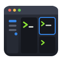
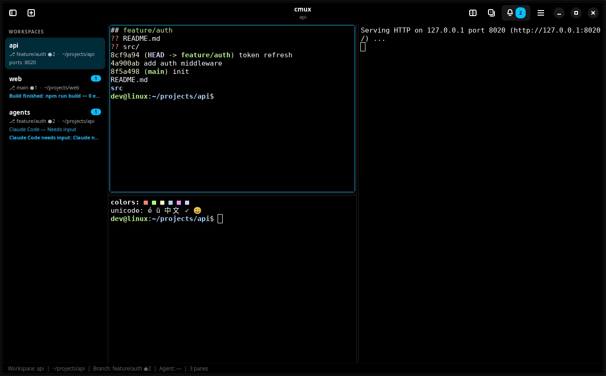
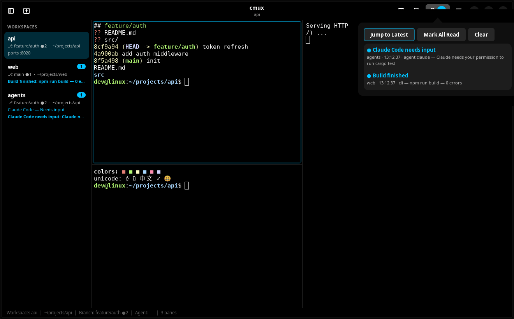
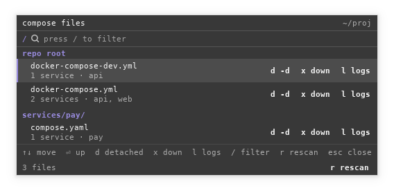

<div align="center">
  
  <h1>OxiShell</h1>
  <p><strong>One terminal for your projects and coding agents.</strong></p>
  <p>A free, open-source terminal for Linux and macOS. Run shells, dev servers, and AI coding agents in
  split panes, and jump straight to the agent that needs your input.</p>
  <p>
    <a href="#quick-start"><strong>Download</strong></a> ·
    <a href="https://ajinkyasp99.github.io/oxishell/">Website</a> ·
    <a href="#documentation">Documentation</a> ·
    <a href="https://github.com/Ajinkyasp99/oxishell/releases">GitHub Releases</a> ·
    <a href="#docker-compose-launcher">Docker Compose</a>
  </p>
  <p>
    <a href="https://github.com/Ajinkyasp99/oxishell/releases/latest"></a>
    <a href="https://github.com/Ajinkyasp99/oxishell/actions/workflows/ci.yml"></a>
    <a href="LICENSE"></a>
  </p>
  <a href="docs/assets/hero.png"></a>
</div>

## Why OxiShell?

Keep each project in its own workspace. Leave the API server and test watcher running, move to another
project, and use the workspace badge or desktop notification to return when Claude Code or Codex needs a
decision. Each pane runs a regular shell, so you can keep using the command-line tools you already know.

OxiShell is a native desktop terminal emulator and an independent cmux alternative for Linux with a
macOS build as well. It pairs VTE terminal rendering with desktop notifications and a sidebar that shows
which agent is active and, when supported by its hooks, whether it is running, waiting, or done.

## Features

- **Workspaces and split panes.** Group projects in a sidebar, open tabs with independent split layouts,
  and move focus by keyboard. Background tabs and workspaces keep running while you switch between them.
  On restart, OxiShell restores layouts and directories. Previous output is optional, and you can
  explicitly resume agent sessions that reported an ID. See [session setup](docs/AGENTS.md#session-resume).
- **Agent awareness.** See recognized agents in the sidebar. Supported hooks add state updates, pane
  highlights, workspace badges, and desktop notifications. Codex and Claude Code can also show local
  usage limits. See [supported agents](#supported-ai-coding-agents).
- **Terminal workflow.** Search command history and scrollback, accept inline suggestions, inspect command
  blocks with exit status and duration, open web links, and [preview files beside the terminal](#project-explorer-and-file-previews).
  Context chips show the active directory, Git branch, and Python environment when available.
- **Appearance and navigation.** Pick from 41 bundled Warp themes, import a theme, adjust the font or
  cursor, and remap shortcuts. The command palette searches actions, workspaces, themes, and custom commands.
- **Local developer tools.** Start a Compose stack from the [launcher](#docker-compose-launcher), inspect
  listening ports and CPU and memory usage in the status bar, or drive the running app with the `oxi` CLI.

## Quick start

### Install on Ubuntu and Debian

**Ubuntu 24.04+ or Debian 13+ on x86-64 (AMD64)**, with an X11 or Wayland desktop. Download
[oxishell_amd64.deb](https://github.com/Ajinkyasp99/oxishell/releases/latest/download/oxishell_amd64.deb),
then run this from the download directory.

```bash
sudo apt install ./oxishell_amd64.deb
```

APT installs GTK4, libadwaita, VTE, and the SVG loader as package dependencies. Git is recommended for
branch information and Compose discovery from the repository root. Launch **OxiShell** from the
application menu or run `oxishell`. The package also provides `oxi`.

### Install on macOS

**macOS 15+ on Apple silicon or Intel.** Install the app and its linked `oxi` command with Homebrew.

```bash
brew install --cask Ajinkyasp99/oxishell/oxishell
```

For a manual install, download the disk image for your Mac and drag **OxiShell** to **Applications**.
[Apple silicon (.dmg)](https://github.com/Ajinkyasp99/oxishell/releases/latest/download/oxishell_macos_arm64.dmg) ·
[Intel (.dmg)](https://github.com/Ajinkyasp99/oxishell/releases/latest/download/oxishell_macos_x86_64.dmg)

Open **OxiShell** from **Applications**. The app uses ad hoc signing, so macOS may require manual
approval on the first launch. If Gatekeeper blocks it, verify your download before using
**System Settings → Privacy & Security → Open Anyway**. [Apple's first-launch instructions](https://support.apple.com/en-us/102445)

For the standalone disk image, see how to put the [bundled `oxi` command on your PATH](docs/INSTALL.md#macos).

### Update

Use the same distribution channel to update. Quit the app before replacing it or restart it after the
update. Your settings, themes, saved layouts, and hooks are kept. See
[update instructions](docs/INSTALL.md#update), [checksum verification](docs/INSTALL.md#from-the-deb-ubuntu-2404-and-newer),
and [source builds](docs/INSTALL.md#from-source).

After launch, [set up your first workspace](#getting-started-with-ai-agents).

## Getting started with AI agents

1. **Open a workspace.** Launch OxiShell, create a workspace with <kbd>Ctrl</kbd>+<kbd>Shift</kbd>+<kbd>N</kbd>
   on Linux or <kbd>⌘</kbd>+<kbd>T</kbd> on macOS, then `cd` to your project.
2. **Split the workspace.** Use the [split-right shortcut](#keyboard-shortcuts) to keep tests or a dev server
   visible beside your agent. Each pane has its own shell.
3. **Set up hooks.** Install your agent CLIs separately and make them available on `PATH`. Enable their
   switches in **Settings → Notifications → Agent Hooks**. The CLI offers the same setup.

   ```bash
   oxi hooks list
   oxi hooks install --all
   ```

   `--all` configures the supported CLIs it finds on `PATH`. You can also install a single agent with
   `oxi hooks install claude`. The [hook guide](docs/AGENTS.md#hooks) lists the settings files and backup behavior.
4. **Start the agents inside OxiShell.** Run `claude` or `codex` in a pane and use the adjacent shell for
   tests. Restart already-running agents after changing hooks. In Codex, open `/hooks` to review and trust
   the OxiShell hooks.
5. **Respond from any workspace.** Click the desktop alert or use **Jump to latest unread** in the
   [shortcut table](#keyboard-shortcuts) to focus the pane.

### Supported AI coding agents

| Agent | Running | Needs input | Finished |
| --- | :---: | :---: | :---: |
| Claude Code | Yes | Yes | Yes |
| OpenAI Codex CLI with lifecycle hooks | Yes | Yes | Yes |
| Gemini CLI | Yes | — | Yes |
| Qoder CLI | — | — | Yes |
| OpenCode plugin | Yes | Yes | Yes |

The table lists events the integrations can report. OpenCode's plugin is implemented and live agent
validation remains open. Older Codex releases can use completion-only notifications. Other tools can
post alerts with `oxi notify` or report state with `oxi agent-event`. If desktop alerts are unavailable,
you can follow events through in-app badges and the Notifications panel.
[Agent setup and limitations](docs/AGENTS.md) · [Notification troubleshooting](docs/TROUBLESHOOTING.md)

## Workflow demos

### Follow agent notifications

Use the Notifications panel to find which agent is waiting and open its pane. For example, keep one
workspace on API tests and another on a Codex task, then jump back when Codex asks for approval.

<details>
<summary>Notifications panel screenshot</summary>
<p><a href="docs/assets/notifications.png"></a></p>
</details>

### Project Explorer and file previews

- Click a local file path in terminal output and choose **Edit File** to start editing at the referenced location.
  The link menu also offers **Preview**, **Open in External Editor**, and **Copy Path**.
  Ctrl-click on Linux or Cmd-click on macOS opens the preview directly. Use **Edit** in the preview to start editing.
- Select the folder button in the header or choose **Explore Project** from the main menu or command palette.
  Expand folders from the focused terminal's Git worktree root, or from its current folder outside Git.
  Opening a text file brings up the editor beside the terminal. **Back to Project** returns to your place in the tree. Use
  **Refresh Project** to pick up files added or removed on disk.
- The editor supports UTF-8 files up to 1 MiB. Autosave writes after one second of inactivity or when
  you leave the editor. Choose **Settings → Terminal → Editor** to change the delay or turn autosave off.
  **Save**, Ctrl+S on Linux, and Cmd+S on macOS still save immediately.
- When another program changes the file, a clean editor refreshes. An editor with a draft pauses
  autosave and keeps your edits. **Reload from Disk** reads the latest version after confirming any discard.
- For binaries, images, and larger files, use **Open with Default App** in the preview header.

### Docker Compose launcher

1. Make a Compose CLI available on OxiShell's `PATH`. It detects `docker compose`, `docker-compose`, or
   `podman compose` in that order. For Docker, check with `docker compose version` and start your Docker engine.
2. Open a pane in your project. The **Compose** icon appears just left of the pane's move handle when
   the app finds a Compose command and a matching YAML file. The scan starts at the Git repository
   root or, outside Git, the pane's current directory.
3. Click the icon or press <kbd>Ctrl</kbd>+<kbd>Shift</kbd>+<kbd>L</kbd> on Linux or
   <kbd>⇧</kbd>+<kbd>⌘</kbd>+<kbd>L</kbd> on macOS. The filter has the keyboard, so just type: it matches
   file paths and service names. Files are grouped by folder, and the last three starts (`up` or `up -d`)
   sit above the list; repeat one with <kbd>Ctrl</kbd>+<kbd>1</kbd>–<kbd>3</kbd> (<kbd>⌘</kbd>+<kbd>1</kbd>–<kbd>3</kbd> on macOS).
   Select a file and press <kbd>Enter</kbd> to run the default action. The selected file shows its actions
   (`up -d`, `up`, `down`, `logs`, `restart`): <kbd>Tab</kbd> walks them, <kbd>Ctrl</kbd>+<kbd>X</kbd> runs `down`,
   <kbd>Ctrl</kbd>+<kbd>L</kbd> follows logs and <kbd>Ctrl</kbd>+<kbd>R</kbd> rescans. On macOS these use
   <kbd>⌘</kbd> so Ctrl stays with the shell.

<a href="docs/assets/compose-picker.png"></a>

The bar below the terminal shows service states and published ports. Use **Rebuild**, **Restart**, or
**Stop**, or click a service chip to restart just that service. Crash and health alerts are configurable.
When the stack stops, the bar shrinks to one line with **run up**, **up -d** and **×**, so you can start
the same stack again without the picker. The line stays while you run up to two more commands in the pane,
then goes away. It works the same on Linux and macOS.
If the launcher is missing or dimmed, check **Settings → Workflow → Docker Compose**, the Compose CLI,
and the pane's working directory and foreground command. Turn off **Run the command right away** to
review generated commands before pressing Enter. [Compose launcher guide](docs/COMPOSE_LAUNCHER.md)

### Codex and Claude usage limits

The sidebar shows 5-hour and weekly usage with reset times when local data is available. Each limit is a row
of cells: five for the hours of the 5-hour window and seven for the days of the week. Cells fill as you use the
limit, a white underline marks the hours or days already gone, and the reset time and date sit underneath. The
meter turns amber at 90% used. It looks the same on Linux and macOS. OxiShell reads
Codex's local session logs. For live Claude Code updates, run `oxi hooks install claude` and restart
the agent to use the status-line bridge. The bridge preserves the output of an existing status-line
command. Usage alerts are configurable in **Settings → Notifications**.
[Agent setup](docs/AGENTS.md#hooks) · [Usage screenshot](docs/assets/usage.png)

### Suggestions and context chips

At the shell prompt, start a familiar command and press <kbd>→</kbd> or <kbd>End</kbd> to accept a
history suggestion. Bash and Zsh integration is automatic. Fish users can append the snippet printed
by `oxi shell-integration fish` to `~/.config/fish/config.fish`. Select a theme in **Settings → Appearance**
or search for one from the command palette.
[History screenshot](docs/assets/history.png) · [Theme gallery](docs/assets/theme-gallery.png) · [Theme guide](docs/THEMES.md)

### Command line

Run `oxi` in a pane to work with the current OxiShell instance. These commands create and list workspaces
from a project directory.

```bash
oxi workspace new --name api --cwd "$PWD"
oxi workspace list
```

The CLI also supports splitting and focusing panes, reading recent output, and posting notifications.
[CLI reference](docs/CLI.md)

## Keyboard shortcuts

| Action | Linux | macOS |
| --- | --- | --- |
| New workspace | Ctrl+Shift+N | ⌘T |
| New tab | Ctrl+Shift+T | ⇧⌘T |
| Split right / down | Ctrl+Shift+E / Ctrl+Shift+O | ⌘D / ⇧⌘D |
| Focus adjacent pane | Alt+Arrow | ⌥⌘+Arrow |
| Switch to workspace 1–9 | Alt+1–9 | ⌘1–9 |
| Command palette | Ctrl+Shift+P | ⇧⌘P |
| Search command history | Ctrl+Shift+H | ⇧⌘H |
| Docker Compose files | Ctrl+Shift+L | ⇧⌘L |
| Notifications panel | Ctrl+Shift+I | ⇧⌘I |
| Jump to latest unread | Ctrl+Shift+U | ⇧⌘U |
| Settings | Ctrl+, | ⌘, |

See **Settings → Shortcuts** for the full list of remappable actions and your current bindings.
[Complete Linux and macOS defaults](src/config.rs) · [Shortcut configuration](docs/CONFIGURATION.md)

## Technology and architecture

**Rust** implements the workspace model, session storage, and local command API. **GTK4 and libadwaita**
provide the desktop interface. **VTE** renders each terminal and manages its pseudo-terminal (PTY).
A background worker handles Git, process, port, and Compose metadata so these checks can run separately
from the UI. Source builds use Rust 1.87+ and require GTK 4.14+ development headers.
[Architecture](docs/ARCHITECTURE.md) · [Technology choices](docs/TECH_STACK.md) · [Packaging](docs/PACKAGING.md)

## Documentation

| I want to… | Read |
| --- | --- |
| Install, update, build, or uninstall | [Installation guide](docs/INSTALL.md) |
| Configure the terminal and workspace behavior | [Configuration](docs/CONFIGURATION.md) · [Keyboard shortcuts](#keyboard-shortcuts) |
| Integrate agents and automate tasks | [Agent hooks and resume](docs/AGENTS.md) · [CLI reference](docs/CLI.md) · [Compose launcher](docs/COMPOSE_LAUNCHER.md) |
| Change the appearance | [Themes](docs/THEMES.md) |
| Diagnose a problem or check a release | [Troubleshooting](docs/TROUBLESHOOTING.md) · [Release notes](docs/RELEASE_NOTES.md) |
| Contribute or report a vulnerability | [Contributing guide](CONTRIBUTING.md) · [Security policy](SECURITY.md) · [Privacy](#privacy--security) |

### Privacy & security

OxiShell has no account system, telemetry, or network listener. The `oxi` CLI uses an owner-only Unix
socket. Sending keystrokes through `oxi pane send` is disabled by default. Session restoration displays
optional saved output as plain text and starts fresh shells. Resume commands wait for you to press Enter.
The optional update check contacts GitHub to show a release notice. [Security policy](SECURITY.md)

## Roadmap

- **Released.** Workspace tabs, split panes, agent hooks, Compose, and installable Linux and macOS builds
  are documented in the [release notes](docs/RELEASE_NOTES.md).
- **Open validation.** Live OpenCode plugin testing and physical-display checks remain open. The release
  notes track macOS runtime coverage. [Project tracker](docs/PHASE_PROGRESS.md) · [Release notes](docs/RELEASE_NOTES.md)
- **Future ideas.** Flatpak packaging and per-project command files are proposals in the
  [roadmap](docs/ROADMAP.md#next-features).

## Contributing

Bug reports, feature requests, documentation, theme fixes, and code are welcome. For a bug, include your
OS, OxiShell version (`oxi --version`), and steps to reproduce. To submit a change, fork the repository,
follow the development setup, run the relevant checks, and open a pull request.
[Open an issue](https://github.com/Ajinkyasp99/oxishell/issues/new/choose) · [Contributing guide](CONTRIBUTING.md)

## Community and support

Use Issues for actionable reports, Discussions for questions or ideas, and the private advisory form
for vulnerabilities.
[Issues](https://github.com/Ajinkyasp99/oxishell/issues) ·
[Discussions](https://github.com/Ajinkyasp99/oxishell/discussions) ·
[Releases](https://github.com/Ajinkyasp99/oxishell/releases) ·
[Website](https://ajinkyasp99.github.io/oxishell/) ·
[Private security advisory](https://github.com/Ajinkyasp99/oxishell/security/advisories/new)

## Project ownership and credits

**Created and maintained by Ajinkya Patil.** [Maintainer profile](https://github.com/Ajinkyasp99)

OxiShell is an independent open-source project inspired by [Manaflow's cmux](https://github.com/manaflow-ai/cmux).
Bundled themes come from Warp and their original authors under Apache 2.0. The bundled Hack font is
credited to Source Foundry and Bitstream under the licenses included with the fonts.
[Warp theme attribution](data/themes/NOTICE.md) · [Hack font attribution](data/fonts/NOTICE.md)

## License

OxiShell is licensed under the **GNU General Public License v3.0 or later**. [License text](LICENSE)
